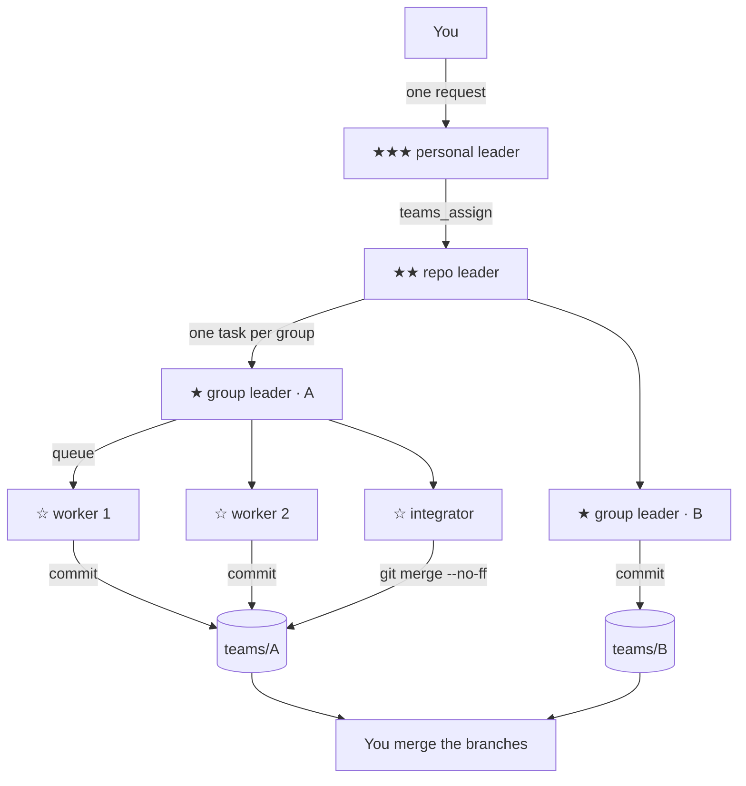

<div align="center">

# omp-teams

**A four-level agent hierarchy for [omp](https://github.com/oh-my-pi), running real omp sessions in [herdr](https://herdr.dev) panes — one git branch per group, merges done by code, brakes that stop the night shift.**

`personal leader → repo leader → group leader → workers`

</div>

> [!NOTE]
> This is an omp **extension**, not a standalone tool. It needs `omp` and `herdr` already
> installed, and every member is a real omp session with its own pane, model and context.

[Quick start](#quick-start) · [How it works](#how-it-works) · [Commands](#commands) · [Agent tools](#agent-tools) · [Configuration](#configuration) · [Brakes](#brakes-and-recovery) · [Reports](#reports-and-audit) · [Testing](#testing) · [Limitations](#limitations)

---

## What it is

You give one sentence to a personal leader. It builds the rest of the team itself: a repo
leader for the repository, group leaders for independent slices of work, and workers in
their own git worktrees. Each group delivers one branch. An integrator merges finished
commits into the group branch with plain `git`. You wake up to branches you can review and
a report with the merge commands.

- **Leaders never execute work.** They get read-only tools plus `teams_*`, enforced by a
  `tool_call` guard, so a cheap manager model delegates instead of editing files.
- **One branch per group, one worktree per worker.** No two sessions can write the same
  checkout. The main branch and the main checkout are never touched.
- **Work must trace to a request.** A leader can only delegate while it holds a task from
  its own manager; closing a task cancels what is still open below it.
- **Everything is in one SQLite file.** Registry, mailbox, tasks, spend, audit. herdr only
  draws panes and launches sessions.

## Requirements

| Requirement | Tested with | Notes |
|---|---|---|
| [`omp`](https://github.com/oh-my-pi) | 18.13.1 | the extension API this is built on |
| [`herdr`](https://herdr.dev) | 0.9.1 | panes, workspaces, `pane report-metadata`, notifications |
| [`bun`](https://bun.sh) | 1.3.14 | runs the extension and its tests |
| `git` | 2.34.1 | worktrees, `merge --no-ff`, `merge-tree` preview |
| OS | Linux | the acceptance suites run on Linux; herdr runs on macOS too |

Model providers are whatever omp supports. Routing defaults to `deepseek/deepseek-flash`
for leaders and `deepseek/deepseek-v4-flash` for workers; change them in the config.

## Install

```bash
git clone https://github.com/magic3007/omp-teams.git
omp plugin link /absolute/path/to/omp-teams
```

Restart omp afterwards. `omp plugin list` should now show `omp-teams@0.1.0`.

The extension is inert until a session registers: a session started by hand stays outside
the team until you run `/teams personal` (or a leader spawns you).

Optional: omp draws the team status line under the input box while
`statusLine.showHookStatus` is enabled.

## Quick start

Inside a herdr pane, start one omp session as the personal leader:

```text
/teams personal
```

Then let it build the chain for a repository (replace the path):

```text
/teams bootstrap --yes --repo ~/code/my-project --group main --count 2
```

This registers the personal leader, spawns a repo leader (waiting for it to register),
spawns a group leader, then N worker seats plus an integrator. herdr shows:

```text
★★ repo leader            ← tab in the repository workspace
★ group leader · main     ← tab, with the integrator split below it
☆ workers · main          ← tab holding the worker panes
```

Now hand it work. Either queue a task for the group:

```text
/teams assign queue feature normal Add a README badge and a CHANGELOG entry, commit, report the SHA
```

or just talk to the personal leader in plain language and let it decide the shape:

```text
Add two new files on a team branch: colors.txt and shapes.txt. Use your team.
```

Watch it with `/teams tree` (an overlay with every member and its omp session id) or read
the status line:

```text
★★★ personal leader │ ★★ 1 repo leader │ ★ 1 group leader │ ☆ 2 workers │ ⟳ 2 running
★ group leader · main │ ⑂ teams/main │ ☆ 2 workers │ ⏳ 1 queued │ ↑ repo leader · my-project
☆ worker 1 · main │ ⑂ teams-w/main/w1 │ ⟳ T-4fa686 add a README badge │ ↑ group leader · main
```

When the work is in, review the branches:

```bash
git -C ~/code/my-project branch --list 'teams/*'
git -C ~/code/my-project log --oneline --graph teams/main
```

…and close the night with a report:

```text
/teams digest
```

## How it works



**Members and seats.** Every member is a row in `teams.db` with a *seat*: `personal`,
`project:<id>`, `group:<project>/<name>`, or `worker:<slot>`. A worker seat is a *slot*, not
a session — a crash, a restart or a context rotation lands back in the same worktree, the
same pane, and inherits open tasks.

**Git model.**

| Level | Branch | Worktree |
|---|---|---|
| group | `teams/<group>` | `$OMP_TEAMS_HOME/wt/<project>/<group>/group` |
| worker | `teams-w/<group>/w<N>` | `…/<group>/w<N>` |

`teams-w/` is a separate namespace because git cannot hold both `teams/main` and
`teams/main/w1`. Workers commit in their own worktree and report the SHA; the integrator
runs `git merge --no-ff` into the group branch. A conflict aborts the merge and comes back
as a pinned rework task with `git rebase teams/<group>`. The integrator records the head it
last wrote: if the branch moves behind its back, merges pause until a human runs
`/teams accept-head <group>`.

**Message delivery.** Mail lives in the same database. Wake messages (tasks, cancels,
questions) are injected with `followUp` + `triggerTurn`; passive reports use `nextTurn`.
Delivery runs on a 2 s poll timer, never during `session_start` (the RPC bridge defers
turns there). Every message is delivered at least once and acknowledged by id.

**Task lifecycle.**

```text
queued ─claim─▶ running ─done─▶ done
   ▲                │
   └─requeue── failed (below the retry limit)
                    │
                    └─▶ blocked (needs a decision)  ─answer─▶ running
any open state ─▶ cancelled (an ancestor task was closed)
```

`done`/`blocked` wake the manager. A task whose descendents are all done is closed
automatically after a two-minute grace window, and the closing report carries the system's
own evidence: every delivered branch, its full head SHA and the files it changes against
the base.

**Model routing.** Peers route per task: explicit `model` (must be in `allowed`) →
`path_rules` → `by_kind` → `by_difficulty` → `default`. Only tasks a worker executes carry
a model; a leader keeps the leader model. A worker switches model before the task lands,
and only while idle.

## Commands

Run `/teams` for the list. Every command works in the session's own pane.

| Command | Who | What it does |
|---|---|---|
| `/teams personal [--force]` | any | register this session as the machine-wide leader |
| `/teams project [--force]` | any | register this session as the repo leader of its repository |
| `/teams group <name> [--worktree <path>] [--force]` | any | register a group leader |
| `/teams join <group>` | any | register this session as a worker of an existing group |
| `/teams spawn project --repo <path>` | personal | spawn a repo leader in its own herdr workspace |
| `/teams spawn group <name>` | repo leader | spawn a group leader and its worktree |
| `/teams spawn worker [--count N]` | group leader | spawn N workers (the integrator comes with the first) |
| `/teams assign <to\|queue> <kind> <difficulty> <task>` | leaders | hand work down one level |
| `/teams queue` | group | the group's task list |
| `/teams tree [--all] [--text] [--paths]` | members | the hierarchy below you with session ids |
| `/teams status` / `progress [--fresh]` | members | member info / subordinate reports |
| `/teams pause <group>` / `resume <group>` | leaders | stop or resume claiming in a group |
| `/teams retire <worker>` | group leader | let a worker go after its current task |
| `/teams accept-head <group>` | leaders | accept a group branch that moved; merges resume |
| `/teams takeover` / `release` | worker | drive this worker pane by hand / give it back |
| `/teams report <text>` | members | report progress to your manager |
| `/teams digest` | members | write today's report and show a notification |
| `/teams audit [--hours N]` | members | export the last N hours as JSON |
| `/teams halt [reason]` / `resume` | leaders | stop all new work / lift the halt and rebuild panes |
| `/teams bootstrap --yes [--repo <path>] [--group <name>] [--count N]` | personal | build all levels in one step |
| `/teams leave` | members | leave the team (the launcher does not restart you) |

Labels contain spaces, so command references use one token: an agent id `a-xxxxxxxx`, a
seat such as `worker:s-1a2b3c4d`, or a unique substring. Tool parameters are JSON and take
the full label.

## Agent tools

Leaders get these tools and nothing that executes work; workers get them next to their
normal tools.

| Tool | Purpose |
|---|---|
| `teams_assign({to?, task, kind, difficulty, paths?, model?, parent_task?})` | give work to a direct subordinate, or queue it (group leaders) |
| `teams_report({status, summary, task_id?, sha?})` | progress / done / blocked / failed, one level up |
| `teams_progress` / `teams_queue` | read-only views of subordinates and the group queue |
| `teams_spawn({role, repo?, group?, count?})` | start a subordinate; returns once it registered |
| `teams_retire` / `teams_pause` | let a worker go / pause a group's hand-out |
| `teams_ask({to, question})` | a peer, your manager, or a direct subordinate |
| `teams_merge({task_id})` | integrator only: merge a finished commit |
| `teams_write_report` | write today's report file and notify |

`kind` is one of `feature|fix|refactor|test|docs|review|frontend|infra`; `difficulty` is
`trivial|simple|normal|hard`. Both are required because they drive routing.

## Configuration

Layered, lowest precedence first:

1. built-in defaults
2. `~/.omp/teams/config.yml` (or `$OMP_TEAMS_HOME/config.yml`)
3. `<repo>/.omp/teams.yml` (per repository, usually committed)

Files are re-read when their size or mtime changes, so a running team picks up an edited
budget or window on its next tick.

```yaml
models:
  role:
    personal:   deepseek/deepseek-flash
    project:    deepseek/deepseek-flash
    group:      deepseek/deepseek-flash
    integrator: deepseek/deepseek-flash
  routing:
    default: deepseek/deepseek-v4-flash
    by_kind:
      merge: deepseek/deepseek-flash
      docs:  deepseek/deepseek-flash
    by_difficulty:
      hard: devin/claude-opus-5-5
  allowed: [deepseek/deepseek-flash, deepseek/deepseek-v4-flash, devin/claude-opus-5-5]
path_rules:
  - { glob: "docs/**", kind: docs, difficulty: trivial }

limits:
  workers_per_tab: 4        # worker panes per herdr tab
  max_workers_total: 100
  worker_max_cost_usd: 50   # passed to workers as --max-cost
  dead_after_seconds: 30    # no heartbeat for this long = dead

poll_ms: 2000
patrol_minutes: 5           # dead-task recovery, escalations, brakes, auto-close
max_task_failures: 2
stall_minutes: 30
rotate: { tasks: 5, context_pct: 70 }
rate_limits: { fresh_per_hour: 4 }

guards:
  budget:
    daily_usd: 200
    prices:                 # used when a provider reports no cost (USD per Mtok)
      "deepseek/*": { input: 0.28, output: 0.42 }
      "*": { input: 1, output: 3 }
  group_blocked_per_hour: 3 # 0 disables
  quiet_until: null         # ISO time; no new work starts before it
  window: null              # e.g. { start: "22:00", end: "06:00" }; wraps midnight

merge:
  verify_command: ""        # run in the group worktree after each merge
  verify_timeout_seconds: 600

auto_integrator: true
worktree_root: ~/.omp/teams/wt
```

| Variable | Effect |
|---|---|
| `OMP_TEAMS_HOME` | moves all state: database, worktrees, launchers, reports, exports |
| `OMP_TEAMS_JOIN` | set by a launcher; the member registers with it at session start |
| `OMP_TEAMS_STOP` | stop file watched by the launcher loop |

Set real prices in `guards.budget.prices` if you rely on the budget: many providers report
`cost: 0` to omp, and omp-teams then prices the reported tokens itself. The default `*`
entry is a coarse guess, not a price list.

## Brakes and recovery

| Brake | Trigger | Effect |
|---|---|---|
| halt | `/teams halt [reason]` | every group paused, members notified, assign and spawn refused; the integrator still merges finished work |
| budget | today's spend ≥ `guards.budget.daily_usd` | groups paused for the day, assign and spawn refused |
| blocked rate | `guards.group_blocked_per_hour` blockers from one group in an hour | that group paused and escalated |
| window | outside `guards.window`, or before `guards.quiet_until` | no new work starts; running tasks finish |

`/teams resume` (no argument, from the personal or a repo leader) lifts the halt, releases
brake pauses (a human pause stays), and rebuilds the herdr layout from the registry:
missing workspaces, tabs and panes are recreated, and members whose process is gone are
relaunched with their original launcher script. The personal leader's own pane is not
rebuilt — it is your entry point.

## Reports and audit

`/teams digest` (or the `teams_write_report` tool) writes
`$OMP_TEAMS_HOME/reports/<date>.md` and raises a herdr notification. It contains:

- one row per group: branch, full head SHA, commits ahead of the base, changed files,
  done/blocked/worker counts, pause reason;
- the blocked tasks with the reason each one gave;
- a merge list with a paste-ready command per branch and a `git merge-tree` conflict preview;
- spend per session;
- an `omp -r <session>` command per member for drill-down.

`/teams audit [--hours 24]` writes `$OMP_TEAMS_HOME/exports/audit-<time>.json` with
projects, groups, agents, slots, tasks, messages, events, usage and brake state.

## Testing

```bash
bun test                  # unit tests: registry, mail, routing, queue, merges, guards, reports
bun run test:e2e          # real `omp --mode rpc` tree: registration, delivery, restart
bun run test:herdr        # M1: layout, ranks, panes, worktrees, SHA reporting
bun run test:herdr:m2     # M2: queue, integrator, pause, restart in place, retire
bun run test:herdr:ui     # UI: status line, widget, /teams tree overlay and keys
bun run test:herdr:auto   # one sentence to the personal leader, then outcome checks
MODE=guards bun scripts/herdr-m3.ts   # also: budget | rebuild | fresh | bootstrap
```

The herdr suites open their own temporary workspaces with an isolated `OMP_TEAMS_HOME` and
close them afterwards (`KEEP=1` keeps them for inspection). Run them inside a herdr pane.
`test:herdr:auto` and the M3 modes spend real tokens.

## Repository layout

| Path | Contents |
|---|---|
| `src/db.ts` | SQLite schema and migrations (v7) |
| `src/identity.ts` | project identity, rank labels, session tags |
| `src/registry.ts` | members, seats, groups, visibility, liveness, revive |
| `src/mail.ts` | mailbox and delivery policy |
| `src/queue.ts` | task state machine, atomic claim, dependencies |
| `src/worktree.ts`, `src/merge.ts` | git worktrees and the deterministic merge |
| `src/policy.ts` | the `tool_call` guards for managers, integrators and workers |
| `src/guard.ts` | brakes, spend ledger, price fallback |
| `src/runtime.ts` | assignment, reports, patrol, closing, merge enqueueing |
| `src/herdr.ts`, `src/spawn.ts` | herdr CLI client, launchers, layout |
| `src/presence.ts`, `src/tree.ts` | status line, widget, `/teams tree` |
| `src/report.ts` | daily report and audit export |
| `src/rebuild.ts` | `/teams resume` machine recovery |
| `src/commands.ts`, `src/tools.ts` | the `/teams` surface and agent tools |

## Limitations

Read these before leaving the team alone overnight.

- **The guards catch honest mistakes, not a sandbox.** They parse the shell command they see
  and refuse branch/ref writes, foreign worktrees and edits outside a worker's worktree.
  Indirect calls (`bash -c "…"`, `env git`, a script the worker writes) are not covered. The
  integrator's head check is the backstop: a rewritten group branch pauses merges.
- **Workers keep omp's memory tools.** With omp's auto-learn enabled, workers can call
  `learn` and `manage_skill`, which may write into your long-term memory and skill library.
  Block them in `src/policy.ts` if that is not what you want.
- **The default price table is a guess.** Configure `guards.budget.prices` for your routes,
  or the budget is only roughly right.
- **The personal leader's pane is yours.** If it dies, restart it; `/teams resume` does not
  recreate it.
- **One branch per group.** A goal that must land on a *single* branch should be one group;
  splitting across groups produces several branches for a human to merge.

## License

MIT, as declared in `package.json`.
